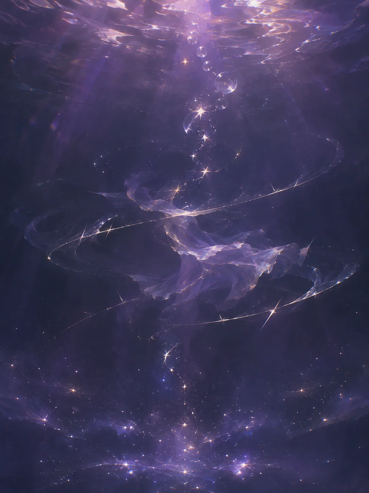

深海的波纹在紫色朦胧中温柔地闪烁，一片对称的星空自下方显现，星星吐出的碎屑向上浮起，钻进她鼻尖冒出的气泡里。

舞者优雅地翩翩起舞，手臂推着海水，伸展出优美的线条。一圈一圈，她旋转着，周身尖锐的饰品在水中划过，留下白色的痕迹。她没有如表演时那样，随着转速加快、裙边飞舞而上升，相反，她被海水包裹着不断下沉。没有东西拉着她，也没有东西阻碍她，旋转扰动了周身的海水，水却寂静如常、不予理睬。她只是自然地下沉。

四周空空荡荡，没有观众，因而也不存在舞者。她旋转地越来越缓慢，直至停下。她维持原有的姿势，眼神没有茫然、只有厌倦，仿佛这一切早已注定。海水没有托住她，托住她的，是彩色的八音盒。